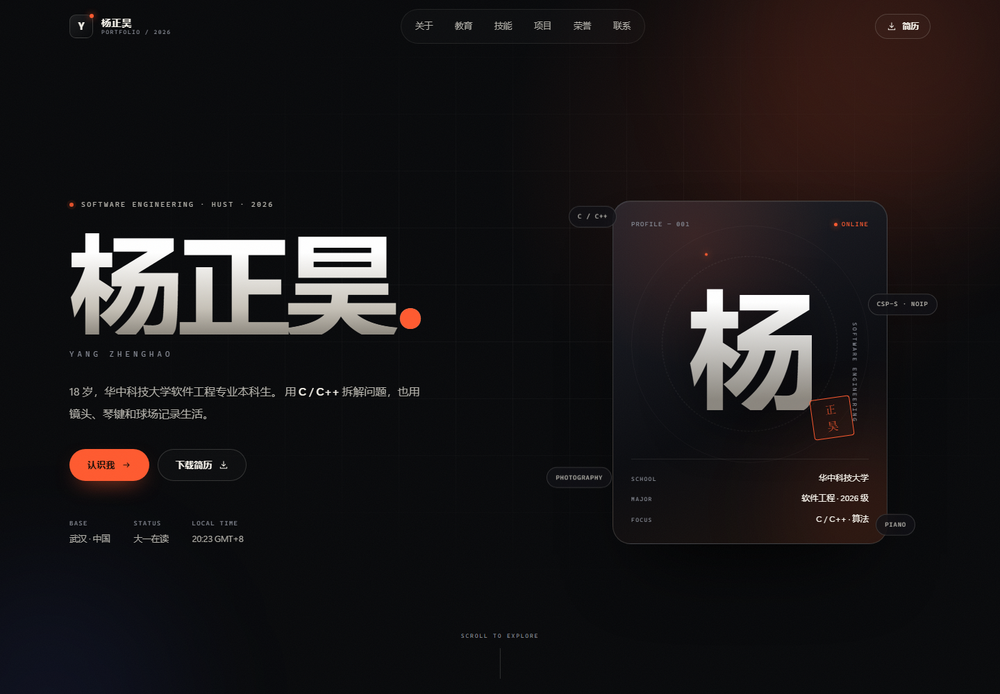

# 杨正昊 · 个人网站

一个根据个人简历制作的中文单页作品集，面向软件工程 / 计算机方向的专业展示。



## 特点

- 纯静态站点：HTML + CSS + 原生 JavaScript，**零依赖、无需构建**
- 响应式布局，已适配 320px – 1440px 视口
- 淡绿色纸面视觉：整体淡绿底色 + 纯白卡片，卡片带细描边与投影，层次清晰
- 滚动渐入、卡片微倾斜、导航高亮
- 项目区为 4 条预留条目（项目 01–04），与教育经历共用同一套时间线列表，复制一条即可继续添加作品
- 教育经历下方预留 3 张横条式论文卡（论文 01–03），复制一张即可继续添加
- 支持 `prefers-reduced-motion`，兼顾动效敏感用户
- 包含 favicon、PWA manifest、社交分享封面与 Person 结构化数据
- 简历 PDF 可直接从站点下载

## 本地预览

直接双击 `index.html` 即可。若需要完整测试复制邮箱等浏览器 API，建议启动一个本地服务器：

```bash
# 任选其一，在项目目录执行
python -m http.server 8000
npx serve .
```

然后访问 `http://localhost:8000`。

## 文件结构

```text
个人网站/
├── index.html              # 页面结构
├── preview.png             # 预览图（README 使用）
├── site.webmanifest        # PWA 配置
├── robots.txt
└── assets/
    ├── css/style.css       # 全部样式与响应式规则
    ├── js/main.js          # 交互与动效逻辑
    ├── resume.pdf          # 简历文件（下载按钮指向这里）
    ├── favicon.svg
    ├── icon-192.png
    ├── icon-512.png
    ├── apple-touch-icon.png
    └── og-cover.png        # 社交分享封面（1200 × 630）
```

## 部署

这是一个纯静态站点，把整个目录上传即可。

**GitHub Pages**

1. 新建仓库，将本目录所有文件推送到 `main` 分支根目录
2. 仓库 `Settings → Pages`，Source 选择 `Deploy from a branch`，分支选 `main` / `root`
3. 几分钟后访问 `https://<用户名>.github.io/<仓库名>/`

**Netlify / Vercel**

将文件夹直接拖入 Netlify Drop，或在 Vercel 中导入仓库，框架选择 “Other”，无需构建命令，输出目录为根目录。

部署后建议：

- 把 `index.html` 中 `og:image` 的 `assets/og-cover.png` 改成完整网址（如 `https://your-domain.com/assets/og-cover.png`），否则部分社交平台无法抓取封面
- 按需补充 `robots.txt` 的站点地图地址
- 如果绑定自定义域名，可再加一个 `CNAME` 文件（GitHub Pages）

## 内容与自定义

- **主色**：`assets/css/style.css` 顶部的 `:root` 中修改 `--accent`（当前为森林绿 `#2f7d55`）、页面底色 `--ink`（当前为近白带绿 `#f9fcf5`）与卡片描边 / 投影 `--paper-border`、`--paper-shadow`
- **文案**：全部在 `index.html` 中，按区块搜索即可
- **简历**：替换 `assets/resume.pdf`，保持文件名不变即可
- **头像 / 照片**：当前使用“杨”字视觉卡片，如需真实照片，可将 `.profile-mark` 内的内容替换为 ``，并同步调整样式

### 新增 / 修改项目条目

项目区目前是 4 条预留条目（项目 01–04），版式与教育经历一致：左侧编号与状态，右侧标题、要点列表与标签行。搜索 `Project Title / Reserved` 就能找到第一条预留条目。

1. 复制任意一整段 `<article class="work-item"> ... </article>`（包含 `.work-date` 与 `.work-body`），粘贴到上一条后面。
2. 修改 `work-num`（编号）、`work-state`（如「待添加」）、`work-top` 里的标题与 `work-badge`（英文副题）、`bullet-list`（要点）与 `work-tags`（标签）。
3. 内容填好后可删掉 `work-state`；继续新增时顺次修改编号与 `style="--d:..."` 的入场延迟即可。
4. 不需要的条目整段删除。`work-tags` 里的各项会自动用 `·` 分隔，无需手动加符号。

项目截图、演示链接等补充内容可直接加在 `work-tags` 之后，或作为新的 `<li>` 放进 `bullet-list`，不需要额外卡片样式。

### 新增 / 修改论文卡片

发表论文区目前是 3 张横条占位卡，搜索 `论文 01` 即可找到第一张。

1. 复制一整段 `<article class="pub-card"> ... </article>`，粘贴到 `.pub-list` 内的相邻卡片后面。
2. 修改 `.pub-index`（编号）、`.pub-title`（论文题目）、`.pub-venue`（期刊 / 会议与年份）与 `.pub-desc`（一句话说明）。
3. 右侧 `.pub-tags` 的四项是待填字段：题目、期刊 / 会议、作者顺序、DOI / 链接；填好后可换成关键词或链接，`.pub-state` 的「待添加」可改成「已发表」。
4. 卡片在桌面端为「编号 / 正文 / 字段」三栏长条，平板收到两行，手机改为上下排列；继续新增时顺次修改编号与 `style="--d:..."` 的入场延迟即可。

## 已验证

- 320 / 390 / 768 / 1024 / 1440 宽度下无横向溢出
- 项目区：4 条预留条目与教育经历同一套时间线版式，桌面端左侧编号、窄屏折到标题上方
- 发表论文区：3 张横条卡片竖排，320 / 390 / 768 / 1024 / 1440 下均无横向溢出
- 移动端菜单开合、Esc 关闭、导航锚点与高亮
- 无控制台报错、无资源加载失败
- 减少动效模式下内容完整可见

## 说明

站点为纯前端静态页面，邮箱、电话等信息会公开在页面源码与结构化数据中；如不希望被爬虫收集或接到推销电话，可在部署后增加简单的邮箱混淆 / 电话需点击显示，或改用联系表单服务。
